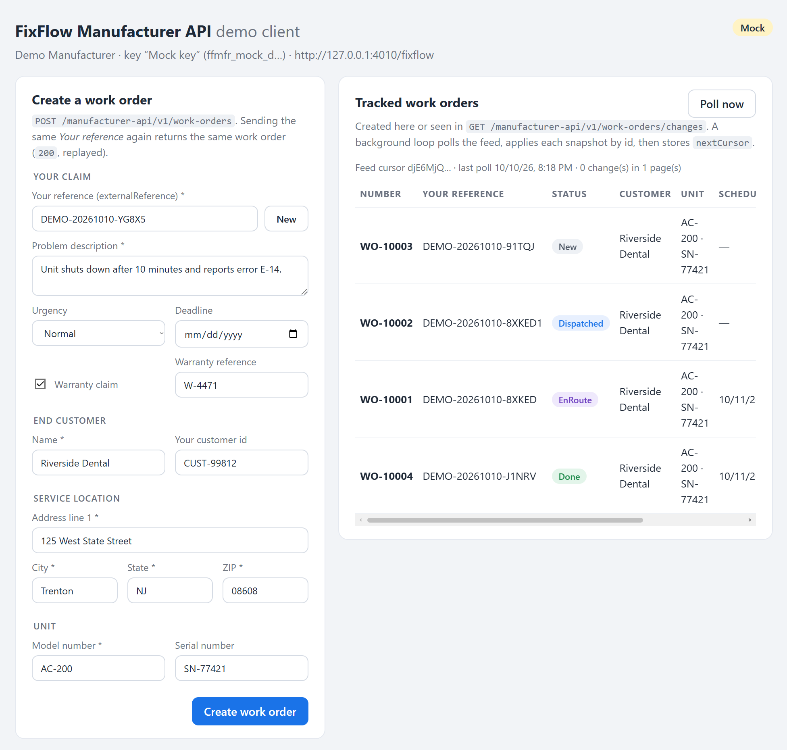

# FixFlow Manufacturer API — demo client



A small reference client for the **FixFlow Manufacturer API v1**. Your system uses this API to send repair
work orders to FixFlow and to track their status by polling.

It shows the whole integration end to end:

- **Verify the key** (`GET /key`).
- **Create a work order** (`POST /work-orders`) with idempotent retries on `externalReference`, and
  field errors on a `422`.
- **Track status** with the polling loop over the change feed (`GET /work-orders/changes`): store the
  cursor, follow `hasMore`, apply snapshots by id.
- **Look work orders up** by FixFlow id, by your own reference, or in a batch.
- **Handle rate limits** (`429` + `Retry-After`).

It runs out of the box against a **built-in mock** of the API, so you can try everything before you
have a key.

The full contract is the FixFlow public API page, `https://<your-fixflow-host>/ui/fixflow/manufacturer-api/`.
A copy of its OpenAPI document is in [`contract/openapi.v1.json`](contract/openapi.v1.json).

## Quick start (no key needed)

Requires Node.js 22 or newer.

```sh
npm install
npm run dev
```

Open <http://127.0.0.1:3000>. With no FixFlow host or key configured, the demo starts an in-process
mock of the API. The mock moves every open work order one status forward every 15 seconds:
`New → Dispatched → Assigned → EnRoute → OnSite → Working → Done`. You can watch the change feed pick
the changes up.

## Run it against FixFlow

1. **Get an API key.** Keys are issued per integrating system and shown **once**. You can get one in
   two ways:
   - on the **API keys** page of the FixFlow manufacturer portal (any active portal user of your
     company can create one, and revoke it there too);
   - from your FixFlow contact.
2. Copy `.env.example` to `.env` and set:

   ```ini
   FIXFLOW_BASE_URL=https://<your-fixflow-host>/fixflow
   FIXFLOW_API_KEY=ffmfr_...
   ```

3. Run `npm run dev` (or `npm run build && npm start`). The badge in the top-right corner changes
   from **Mock** to **Live**.

> **Careful:** in live mode every work order you create is real. It lands in FixFlow's dispatch
> queue, and a dispatcher will act on it.

**Never put the key in a browser.** The browser part of this demo only talks to the demo's own
`/api/*` routes. The Node server holds the key and calls FixFlow.

## What to look at

| File | What it shows |
| --- | --- |
| [`src/fixflow/client.ts`](src/fixflow/client.ts) | A dependency-free API client: `X-Api-Key`, problem details → `FixFlowApiError`, the `429` retry after `Retry-After`, create with the `replayed` flag. |
| [`src/fixflow/types.ts`](src/fixflow/types.ts) | The v1 contract as TypeScript types (statuses, resource, change page, batch, problem details). |
| [`src/sync/poller.ts`](src/sync/poller.ts) | The recommended polling loop. |
| [`src/sync/state-store.ts`](src/sync/state-store.ts) | Where the cursor lives. Apply a page, **then** store its `nextCursor`. |
| [`src/mock/mock-api.ts`](src/mock/mock-api.ts) | The mock API, kept faithful to the contract by `test/contract.test.ts`. |
| [`src/web/app.ts`](src/web/app.ts), [`public/`](public/) | The demo UI and its small backend. |

### The polling loop in short

1. **First start.** Call `GET /work-orders/changes` without a cursor. You get no items and a
   `nextCursor`: that subscribes you from now on. Store the cursor.
2. **Every 30–60 seconds.** Call `GET /work-orders/changes?cursor=<stored>`. Apply every item, then
   store the new `nextCursor`.
3. **While `hasMore` is `true`.** Call again straight away.

Rules that matter:

- **Every item is the current snapshot** of a work order, not a diff.
- **Delivery is at-least-once.** The same work order can come again, so apply items by `id`.
- **Changes appear after about 5 seconds**, not instantly.
- **Creating a work order is not a feed event.** Keep the `201` response; later status changes come
  through the feed.
- **To replay history**, call with `since=<ISO time>` instead of a cursor.

### Idempotency

`externalReference` (your claim or case number) is the idempotency key:

- the first `POST` creates the work order (`201`);
- any later `POST` with the same value returns the same work order unchanged (`200` + header
  `Idempotent-Replayed: true`).

So a request that timed out can always be retried safely. In the UI, submit the form twice without
pressing **New** to see it.

## Scripts

| Command | Does |
| --- | --- |
| `npm run dev` | Runs the demo with auto-reload (TypeScript via `tsx`). |
| `npm run build` / `npm start` | Compiles to `dist/` and runs the compiled app. |
| `npm test` | Runs the client, poller and contract tests against the mock (`node:test`). |
| `npm run typecheck` | Type-checks everything. |
| `npm run mock` | Runs only the mock API on <http://127.0.0.1:4010/fixflow> (key `ffmfr_mock_demo_key`), so you can point your own client at it. |

Settings (all optional) are listed in [`.env.example`](.env.example).

## Notes

- **State storage.** The demo keeps its state in `data/<mode>/state.json`. A real integration keeps the
  cursor and the work orders in its own database, in the same transaction as the applied changes.
- **The mock is a simplification.** It follows the documented behaviour of v1, but the real API
  matches the customer, service location and unit more thoroughly. The public API page describes
  those rules.

## License

[MIT](LICENSE).
